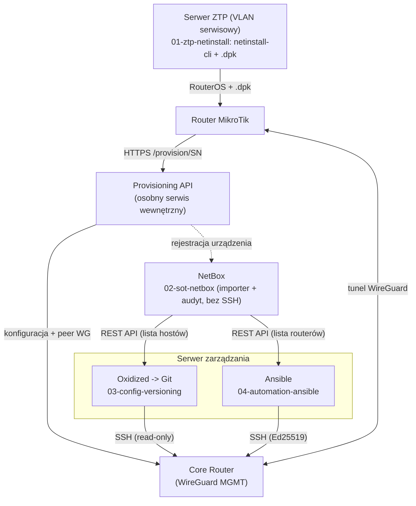

# MikroTik NetOps Automation

Zanonimizowana wersja narzędzi używanych produkcyjnie przy zarządzaniu flotą **ponad 100** urządzeń MikroTik (**RouterOS v6/v7** oraz switchy **SwOS CSS326/CRS328**) rozproszonych u wielu klientów.

Narzędzia powstały po to, żeby wyeliminować ręczne klikanie przy przygotowywaniu nowych routerów, pilnowaniu aktualności NetBoxa, sprawdzaniu backupów i masowych audytach. Spinają cały cykl życia urządzenia — od wyjęcia routera z pudełka (ZTP), przez Source of Truth w NetBoxie i historię konfiguracji w Git, po zarządzanie przez Ansible.

## Architektura

## Jak wygląda cały proces

1. **Podłączenie routera:** Nowy router w trybie Netinstall podłączam do gniazda PoE w izolowanym VLAN-ie serwisowym (oddzielonym od sieci produkcyjnej, żeby BOOTP nie kolidował z DHCP).
2. **Automatyczny Netinstall (`01-ztp-netinstall`):** Usługa `systemd` z `netinstall-cli` wykrywa urządzenie, wgrywa RouterOS wraz z paczką `.dpk` (ze skryptem startowym) i wysyła powiadomienie na Telegram.
3. **Provisioning:** Po restarcie router odczytuje swój numer seryjny, pobiera przygotowaną konfigurację z autorskiego *Provisioning API* (osobny serwis wewnętrzny poza tym repozytorium), zestawia tunel WireGuard do Core Routera i automatycznie trafia do NetBoxa.
4. **Import i audyt NetBoxa (`02-sot-netbox`):** Ręcznie uruchamiane skrypty na serwerze z NetBoxem (pracujące wyłącznie lokalnie na plikach i REST API, bez dostępu SSH do routerów) służą do importu urządzeń z plików `.rsc` (RouterOS) i `.swb` (SwOS), uzupełniania braków (`--only-new`) oraz audytu spójności między peerami WireGuard, NetBoxem i Oxidized.
5. **Automatyczne backupy konfiguracji (`03-config-versioning-oxidized`):** Oxidized w Dockerze pobiera listę aktywnych routerów z NetBoxa po REST API, łączy się po WireGuard na dedykowane konto tylko do odczytu (`oxidized`, klucz RSA 4096) i zapisuje eksporty w Git.
6. **Automatyzacja i audyt floty (`04-automation-ansible`):** Ansible pobiera listę routerów z NetBoxa (`nb_inventory`) i łączy się z routerami RouterOS v7 po WireGuard z dedykowanego konta `ansible` (klucz Ed25519).

## Zawartość repozytorium

| Katalog | Opis |
| :--- | :--- |
| [`01-ztp-netinstall/`](01-ztp-netinstall/README.md) | Usługa `systemd` wokół `netinstall-cli` (Python), obsługa paczki `.dpk` i powiadomienia na Telegram |
| [`02-sot-netbox/`](02-sot-netbox/README.md) | Importer plików `.rsc`/`.swb` do NetBoxa (`sync_mikrotik_to_netbox.py`) oraz skrypt audytowy (`audit_wg_reconciliation.py`) |
| [`03-config-versioning-oxidized/`](03-config-versioning-oxidized/README.md) | Oxidized w Dockerze podpięty do REST API NetBoxa |
| [`04-automation-ansible/`](04-automation-ansible/README.md) | Pobieranie listy routerów z NetBoxa (`nb_inventory`), bootstrap konta `ansible` i audyt Read-Only floty RouterOS v7 |

## Technologie

Python 3 (`pynetbox`), Ansible (`community.routeros`, `netbox.netbox`), NetBox REST API, Oxidized, Docker Compose, WireGuard, `systemd`, MikroTik RouterOS / SwOS.

---

Szczegółowy opis działania, zmienne środowiskowe i instrukcje uruchomienia znajdują się w plikach `README.md` w poszczególnych katalogach.
